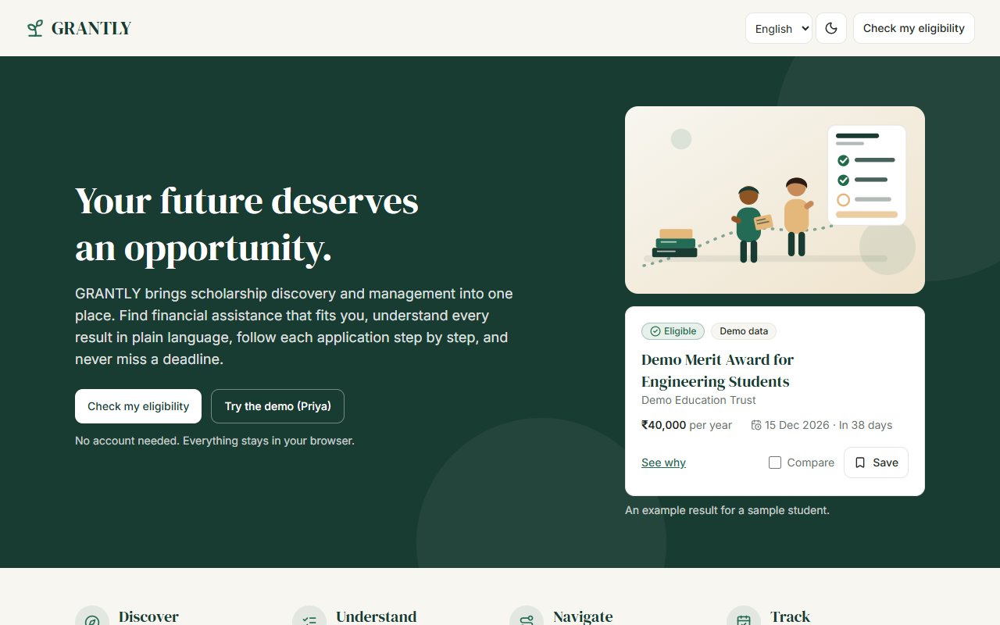
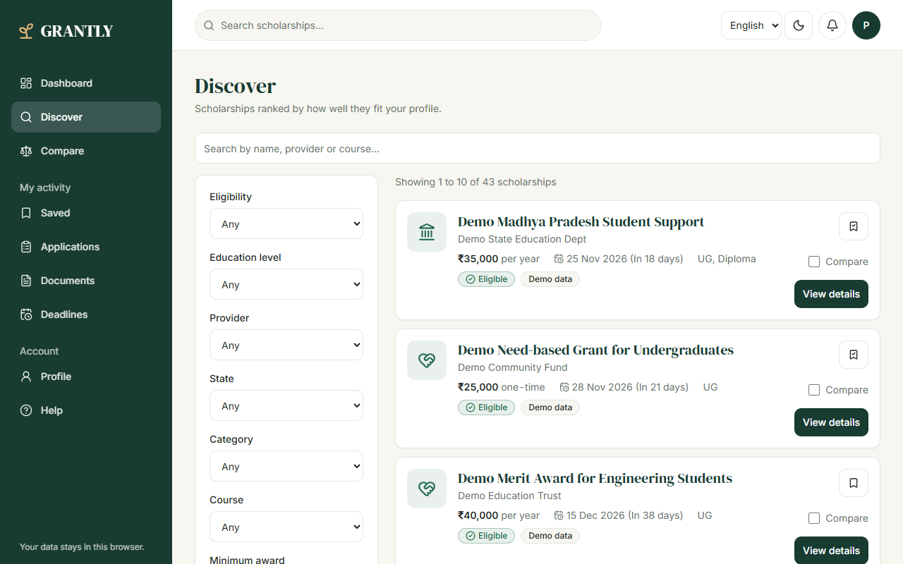
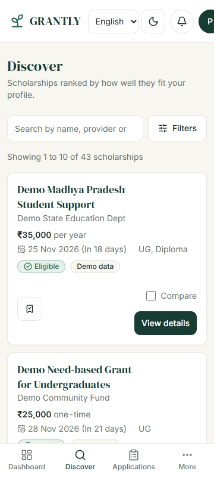
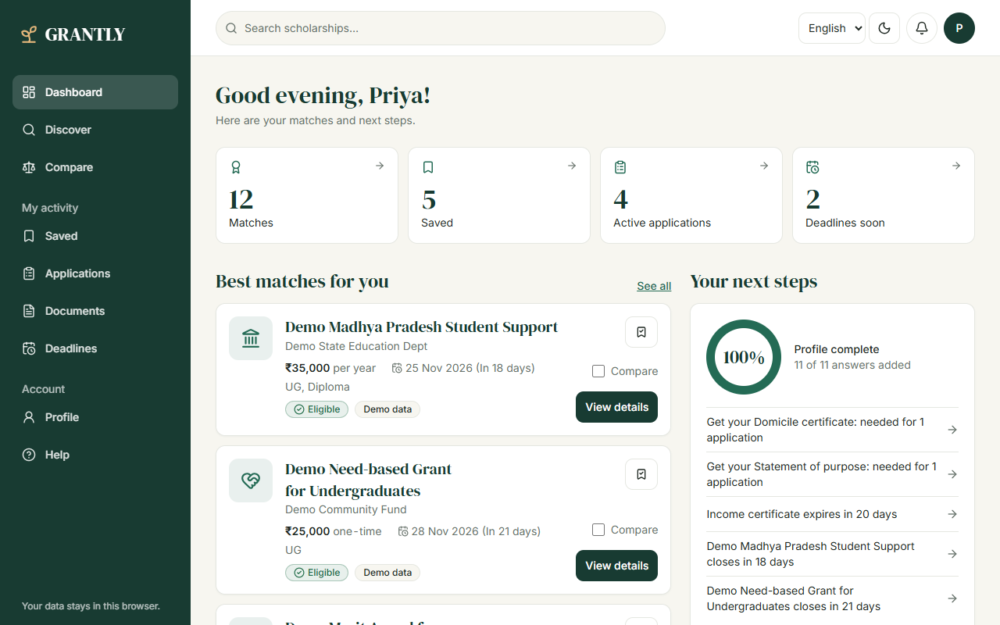
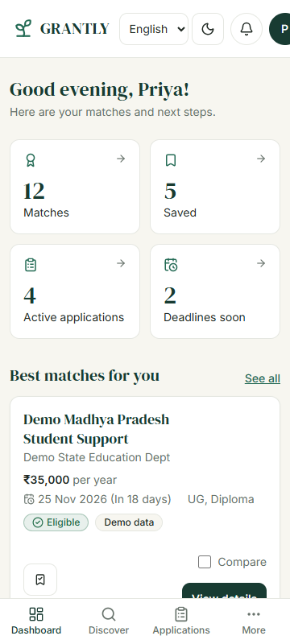
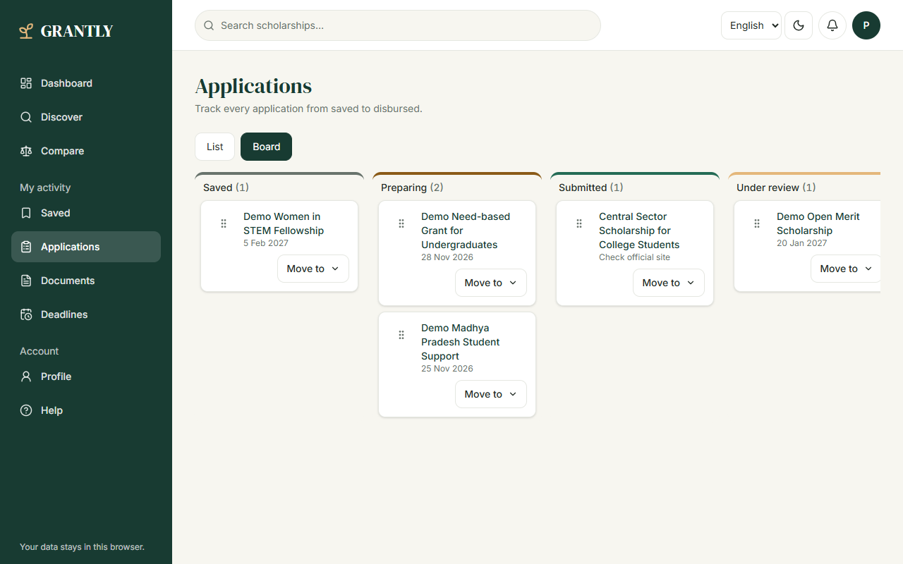
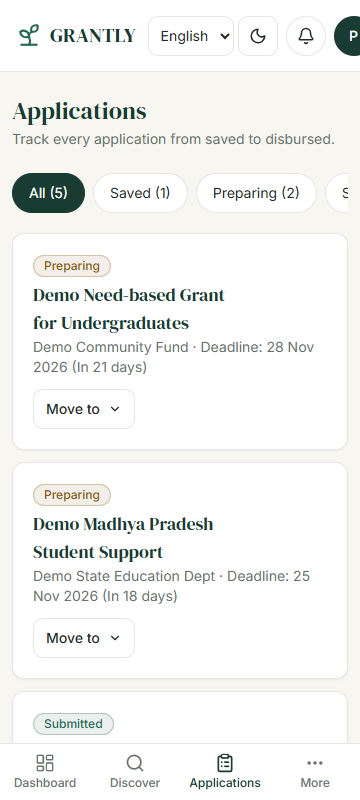
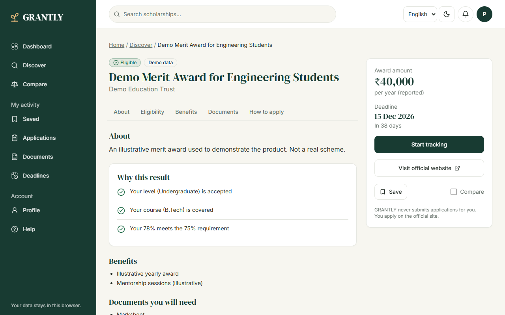
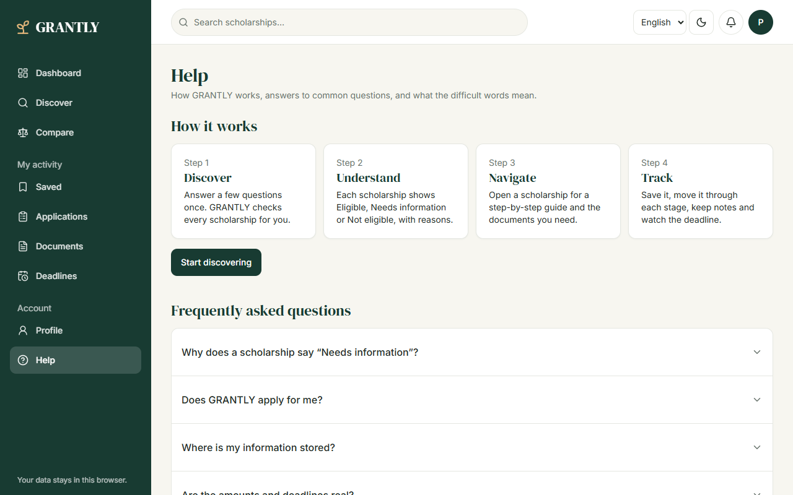
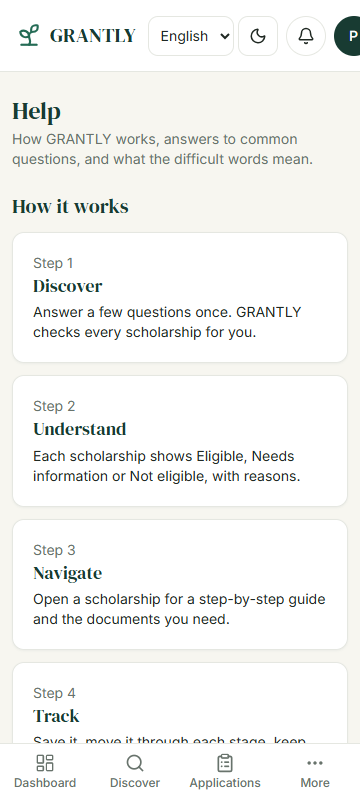

# GRANTLY

**Find your fit. Follow through.**

[](https://github.com/visheshpandey/Vidyaan/actions/workflows/ci.yml)  

## Objective

Students in India miss scholarships they qualify for because the information is scattered, written in dense language, and hard to track across deadlines and documents. GRANTLY puts discovery, eligibility, application steps, documents and deadlines in one simple, accessible, bilingual place, and never applies on the student's behalf.

Personas and user stories: [docs/PERSONAS.md](docs/PERSONAS.md) and [docs/USER_STORIES.md](docs/USER_STORIES.md). Each requirement is traced to code and to tests whose titles carry the requirement ID.

**GRANTLY is a unified scholarship discovery and management platform.** It is our answer to the challenge _Rethinking the Scholarship Experience_: help students **find** relevant educational financial assistance, **understand** the options in plain language, **navigate** each application step by step, and **keep track** of deadlines, documents and progress, so a complicated journey becomes a seamless digital one that is simple, intuitive and accessible.

## How GRANTLY answers the brief

| The brief says                            | What GRANTLY does                                                                                                           | Where                                                          |
| ----------------------------------------- | --------------------------------------------------------------------------------------------------------------------------- | -------------------------------------------------------------- |
| "Finding relevant opportunities"          | Eligibility-first Discover: search, filters (kept in the URL), sorting, best matches first, Compare                         | `features/discover`, `features/matching`, `pages/Discover.tsx` |
| "Understanding available options"         | Every scholarship shows Eligible, Needs information or Not eligible with the exact reasons, a glossary and a Help page      | `features/matching/EligibilityBreakdown.tsx`, `pages/Help.tsx` |
| "Navigating application processes"        | Step-by-step guide per scholarship, application tracker (Saved to Disbursed), board with drag-and-drop, official links only | `features/applications`, `pages/ApplicationDetail.tsx`         |
| "Keeping track of important information"  | Notes, document readiness with expiry dates, deadline calendar, `.ics` export, reminders, history                           | `features/documents`, `features/deadlines`                     |
| "Simpler, more intuitive, and accessible" | Four-step onboarding, plain language, keyboard and screen-reader support, dark mode, English and Hindi, mobile first        | `pages/Onboarding.tsx`, `docs/ACCESSIBILITY.md`                |
| "Seamless digital journey"                | One flow: onboard, match, save, track, prepare documents, meet deadlines, with demo data to try it in one click             | `features/demo`, `e2e/journey.spec.ts`                         |

Acceptance criteria and where each one is implemented and tested are in [docs/REQUIREMENTS.md](docs/REQUIREMENTS.md).

It is a frontend-only app. There is no backend and no account: everything is stored in your browser.

## What it does

| Problem                                         | Feature                                                                                                                                              |
| ----------------------------------------------- | ---------------------------------------------------------------------------------------------------------------------------------------------------- |
| Hard to know which scholarships you qualify for | Eligibility engine with three outcomes: **Eligible**, **Needs information**, **Not eligible**, each with the exact reasons                           |
| Skipped answers wrongly treated as failures     | A missing answer is never "not eligible". It becomes "Needs information" with a link to add it                                                       |
| Too many scholarships to browse                 | Discover: debounced search, filters kept in the URL (shareable), removable chips, sorting by match, deadline or amount                               |
| Applications get lost                           | Tracker from Saved to Disbursed with notes and history. Change status with the "Move to" menu, or drag cards on the board (mouse, touch or keyboard) |
| Missing paperwork                               | Documents page with expiry dates and per-application readiness                                                                                       |
| Missed dates                                    | Deadlines calendar, upcoming list, `.ics` export and an optional once-a-day browser reminder                                                         |
| Choosing between options                        | Compare up to three scholarships side by side                                                                                                        |
| Different languages and lighting                | Dark mode, and English or Hindi for the main screens                                                                                                 |
| Data lock-in                                    | Export everything as JSON, applications as CSV, or clear it all                                                                                      |

GRANTLY never submits an application for you. "View official application" always opens the provider's own site.

## Screenshots

| Screen       | Desktop (1280)                                                     | Phone (360)                                                     |
| ------------ | ------------------------------------------------------------------ | --------------------------------------------------------------- |
| Welcome      |            |            |
| Discover     |          |          |
| Dashboard    |        |        |
| Applications |  |  |
| Scholarship  |    |    |
| Help         |                  |                  |

Tablet (768) versions of Welcome, Discover and Dashboard are in `docs/screenshots/`. To regenerate them, run `npm run build`, start `npx vite preview --port 4177`, then run `npm run screenshots`.

## Data honesty

No scholarship in the bundled dataset is marked "verified". Five records describe real schemes (AICTE Pragati, AICTE Saksham, Central Sector, MP Medhavi Vidyarthi, Reliance Foundation UG) with links to the official portals. Ten are fictional demo records. All are labelled **Demo data** in the UI. Where an official deadline is unknown the app shows "Check official site" and never invents one. A test fails the build if a record claims to be verified without a check date.

## Quick start

```bash
npm install
npm run dev          # http://localhost:5173
```

Press **Try the demo (Priya)** on the landing page to load a sample student with applications and documents.

| Script                  | Purpose                            |
| ----------------------- | ---------------------------------- |
| `npm run dev`           | Start the dev server               |
| `npm run build`         | Typecheck and build for production |
| `npm run preview`       | Serve the production build         |
| `npm run lint`          | Lint with ESLint (type-aware)      |
| `npm run typecheck`     | TypeScript strict check            |
| `npm test`              | Run unit and accessibility tests   |
| `npm run test:coverage` | Tests with coverage                |

## Environment

No configuration is required. To change defaults, copy [.env.example](.env.example) to `.env.local`. All variables are optional and validated at startup in `src/config/env.ts`; a missing or malformed value falls back to a safe default. Code reads config from `env`, never from `import.meta.env` directly.

| Variable              | Default   | Purpose                                        |
| --------------------- | --------- | ---------------------------------------------- |
| `VITE_APP_NAME`       | `GRANTLY` | Product name in the UI                         |
| `VITE_API_BASE_URL`   | empty     | Our own backend. Empty means bundled data only |
| `VITE_API_TIMEOUT_MS` | `8000`    | Request timeout                                |
| `VITE_API_CACHE_MS`   | `600000`  | Response cache time (10 minutes)               |

`VITE_` variables are public in the built site, so never put secrets in them. The browser only calls our own backend, with a fallback to bundled data if it is down (`src/api/`).

## Stack

React 19, TypeScript (strict), Vite, Tailwind CSS v4, React Router, Zustand, Zod, Radix UI primitives, date-fns, Vitest, Testing Library and jest-axe.

## Architecture in short

```
src/
  app/          router, route guard, error boundaries
  pages/        one file per route, thin
  features/     business logic and feature components (matching, discover, applications, ...)
  components/   generic ui/ and layout/
  store/        Zustand stores, one per domain
  services/     storage, exports, scholarship source
  api/          HTTP client for a future backend (timeout, validation, cache, fallback)
  config/       validated environment variables
  i18n/         English and Hindi
```

Match results are derived from the profile on every render and never stored. Stored data is validated on read and falls back to safe defaults if it is corrupt. See [docs/ARCHITECTURE.md](docs/ARCHITECTURE.md).

## Accessibility

Skip link, labelled form fields with associated errors, status shown with icon and text (never colour alone), keyboard-operable menus, dialogs and drag-and-drop, live regions for results and toasts, reduced-motion support, 44px touch targets, text contrast checked in light and dark themes. Every page is checked with axe in the test suite. See [docs/ACCESSIBILITY.md](docs/ACCESSIBILITY.md).

## Performance

Self-hosted fonts with a metric-matched fallback (no render-blocking third-party requests), the landing page in the first bundle and every other route loaded on demand, React in its own long-cached chunk, immutable caching for hashed assets, debounced search, and reserved space to avoid layout shift. Mobile Lighthouse on the live site: first and largest paint 0.8 s, no layout shift, accessibility 100, SEO 100, best practices 96. Main-thread blocking time is the remaining area to improve.

## Testing and quality

| Check                    | Command                 | What it covers                                                                                         |
| ------------------------ | ----------------------- | ------------------------------------------------------------------------------------------------------ |
| Lint                     | `npm run lint`          | ESLint with type-aware TypeScript rules, React hooks, jsx-a11y. Zero errors                            |
| Types                    | `npm run typecheck`     | TypeScript strict plus `noUncheckedIndexedAccess`, `noImplicitReturns`, no `any`                       |
| Unit and component tests | `npm test`              | Matching engine, stores, storage, sanitizers, API client, every page with axe, user flows              |
| Coverage                 | `npm run test:coverage` | Fails below 80 percent statements, 75 percent branches                                                 |
| End to end               | `npm run e2e`           | Real browser on desktop and phone sizes: demo journey, search in URL, tracking, 404, no console errors |
| All at once              | `npm run check`         | Lint, typecheck, tests and build                                                                       |

CI runs all of these on every push. Dependabot keeps dependencies current. See [SECURITY.md](SECURITY.md).

## Security and privacy

- No backend, no tracking, no third-party calls other than Google Fonts.
- Content-Security-Policy and other headers are set in `vercel.json`.
- All stored data is parsed with Zod; corrupt data is discarded, not trusted.
- External links use `rel="noopener noreferrer"`.
- CSV export neutralises spreadsheet formula injection.
- Documents are tracked by name and date only; files are never read or stored.

## Deploying

The build output in `dist/` is a static site. On Vercel, import the repository and keep the defaults (build `npm run build`, output `dist`). `vercel.json` already contains the single-page-app rewrite and security headers.

## Documentation

| Document                                           | What it covers                                                 |
| -------------------------------------------------- | -------------------------------------------------------------- |
| [docs/REQUIREMENTS.md](docs/REQUIREMENTS.md)       | Requirements R1.1 to R6.4 traced to code and tests             |
| [docs/USER_STORIES.md](docs/USER_STORIES.md)       | User stories with Given/When/Then criteria                     |
| [docs/PERSONAS.md](docs/PERSONAS.md)               | The three students we design for                               |
| [docs/ARCHITECTURE.md](docs/ARCHITECTURE.md)       | Layers and where code belongs                                  |
| [docs/ACCESSIBILITY.md](docs/ACCESSIBILITY.md)     | Accessibility approach and checks                              |
| [docs/API.md](docs/API.md)                         | Data layer, environment variables, JSON shape, backend plug-in |
| [docs/DEPLOYMENT.md](docs/DEPLOYMENT.md)           | Vercel, headers, service worker, verification                  |
| [docs/TROUBLESHOOTING.md](docs/TROUBLESHOOTING.md) | Common problems and fixes                                      |
| [SECURITY.md](SECURITY.md)                         | Security policy and measures                                   |
| [CONTRIBUTING.md](CONTRIBUTING.md)                 | How to contribute                                              |
| [CODE_OF_CONDUCT.md](CODE_OF_CONDUCT.md)           | Community standards                                            |
| [CHANGELOG.md](CHANGELOG.md)                       | Release notes                                                  |

## Roadmap

Full Hindi coverage of every screen, and replacing the bundled dataset with verified records.

## License

MIT
