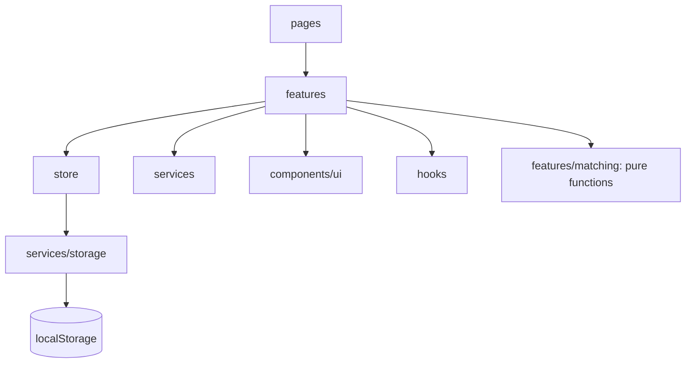

# Architecture

## Layers

Dependencies point one way only.

- **pages** compose features and own routing concerns.
- **features** hold behaviour: matching, discover filters, dashboard selectors, applications, documents, deadlines.
- **components/ui** has no business logic.
- **store** (Zustand) is split by domain: profile, tracker, documents, UI toasts. Every action persists through the storage service.
- **services** wrap everything outside React: storage, the scholarship source, exports.

## Eligibility engine

`evaluate(profile, scholarship)` is a pure function. For each rule the scholarship defines it returns `met`, `not-met` or `unknown`.

1. Any known `not-met` rule means **Not eligible**. One failure beats unknowns.
2. Otherwise any `unknown` means **Needs information**. A missing answer is never a failure.
3. Otherwise **Eligible**. A scholarship with no rules is eligible.

There are no tolerance margins and no percentage scores. Ranking is verdict, then soonest deadline (unknown last), then amount.

## Storage

Keys are versioned (`vidyaan:v1:*`). `loadJSON` parses with a Zod schema and returns a fallback on missing, corrupt or invalid data. Storage errors (private mode, quota) are caught.

## Data source

`scholarshipService` is async on purpose. It mirrors a network API, so a real backend can replace the bundled JSON without touching the UI.

## Derived, not stored

Match results and dashboard metrics are calculated from the profile, saved list, applications and documents. They cannot go stale.
