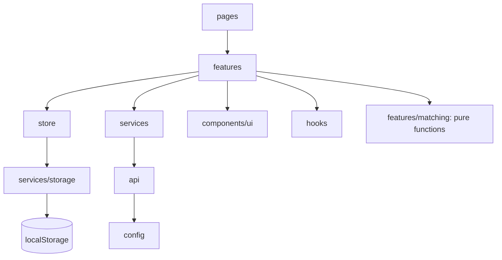

# Architecture

GRANTLY is a frontend-only React app. All data lives in the browser. This page explains how the code is organised so you can find things and add features without making a mess.

## Folder map

```
src/
  app/          App wiring only: router, route guard, error boundaries, theme sync
  pages/        One file per route. Compose features and UI. No business rules here
  features/     Business logic and feature-specific components, one folder per feature
    matching/       Eligibility engine (pure functions), ranking, verdict badge
    discover/       Filters, URL state hook, filter UI
    applications/   Status transitions, selectors, board, list item, status menu
    dashboard/      Metric selectors, profile completeness, profile ring
    documents/      Readiness calculations
    deadlines/      Calendar events, reminders, .ics builder
    compare/        Compare toggle
    scholarships/   Scholarship card, row, save button
    onboarding/     Per-step validation
    demo/           Demo persona loader and "clear all data"
  components/
    ui/         Generic building blocks (Button, Card, Modal, fields). No business logic
    layout/     App shell, sidebar, bottom nav, header, logo
  store/        Zustand stores (state only), one per domain
  services/     Things outside React: localStorage, exports, scholarship source
  api/          HTTP client for a future backend: timeout, validation, cache, fallback
  config/       Environment variables, validated once
  hooks/        Shared hooks used by more than one feature
  i18n/         English and Hindi dictionary and the `useT` hook
  data/         Bundled scholarships, demo data, Zod schemas
  types/        Shared TypeScript types
  constants/    Routes, nav items, storage keys, limits, form options
  utils/        Small pure helpers (dates, formatting, form parsing)
tests/          Cross-page tests (accessibility)
docs/           This documentation
```

## Layers

Dependencies point one way. Nothing lower imports anything higher.



### Where logic lives

The rule: a component renders, a feature module decides.

| Concern | Lives in | Example |
| --- | --- | --- |
| Eligibility rules | `features/matching` | `evaluate(profile, scholarship)` |
| Filtering and URL state | `features/discover` | `useDiscoverFilters`, `applyFilters` |
| Status changes | `features/applications/transitions.ts` | `applyStatus` |
| Counts and lists for a page | `features/*/selectors.ts` | `buildDashboard`, `filterByStatus` |
| Readiness | `features/documents/readiness.ts` | `overallReadiness` |
| Persistence | `services/storage.ts` | `loadJSON`, `saveJSON` |
| Rendering | `pages/` and `components/` | everything JSX |

Pure functions have unit tests next to them. Pages stay thin: read from stores, call a feature function, render.

## State management

Zustand, split by domain: `profileStore`, `trackerStore` (saved plus applications), `documentStore`, `settingsStore` (theme, language, reminders), `compareStore` (session only), `uiStore` (toasts).

- Stores hold state and actions only. Rules live in feature modules the stores call.
- Every persisted store writes through `services/storage` on each action and can `reload()` from storage.
- Derived data (match results, dashboard numbers) is computed with `useMemo` and never stored, so it cannot go stale.

## Storage

Keys are versioned (`grantly:v1:*`). `loadJSON` parses with a Zod schema and returns a fallback for missing, corrupt or invalid data. Storage errors (private mode, full quota) are caught.

## Eligibility engine

`evaluate(profile, scholarship)` returns `met`, `not-met` or `unknown` for each rule, then one verdict.

1. Any known `not-met` rule means **Not eligible**. One failure beats unknowns.
2. Otherwise any `unknown` means **Needs information**. A missing answer is never a failure.
3. Otherwise **Eligible**. A scholarship with no rules is eligible.

No tolerance margins and no percentage scores. Ranking is verdict, then soonest deadline (unknown last), then amount.

## API layer (ready for a backend)

The app runs on bundled data today. `src/api` is the seam where a real backend plugs in.

- `config/env.ts` validates `VITE_*` variables once. Nothing else reads `import.meta.env`.
- `api/httpClient.ts` is a GET-only JSON client with a timeout. Every response is validated with a Zod schema. Failures throw `ApiError`.
- `api/cache.ts` is a small TTL cache (10 minutes by default).
- `api/scholarshipsApi.ts` fetches from `VITE_API_BASE_URL` when it is set. On any failure it falls back to the bundled data, so the app keeps working offline.
- `services/scholarshipService.ts` is the only thing UI code calls.

Rules for any API added later: call your own backend only, never a third-party API straight from the browser. Keys stay on the server, never in `VITE_` variables.

## Error handling

- Route errors show `RouteError` with a reload button. Rendering bugs fall back to `ErrorBoundary`.
- Storage reads never throw. Corrupt data resets to defaults.
- Downloads, notifications and demo loading return success flags or are wrapped in try/catch, and the UI shows a toast on failure.
- Network calls throw `ApiError` and always have a fallback.

## Adding a feature

1. Put pure rules in `features/<name>/` with a test.
2. Add a store only if the data must survive a refresh or be shared across pages.
3. Build the page in `pages/`, reusing `components/ui`.
4. Add a route in `app/router.tsx` and a nav item in `constants/nav.ts`.
5. Add strings to `i18n/dictionary.ts` (English and Hindi).
6. Add the page to `tests/pages.a11y.test.tsx`.
